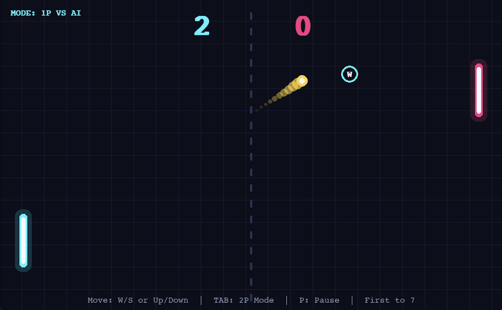

# Neon Pong
_ping pong. ping pong._

A retro-styled Pong minigame built with Python and Pygame. Play solo against a simple AI opponent or switch to local two-player mode, with mid-rally power-ups that widen paddles or apply directional slow effects.

## Features

- **1P vs AI and 2P Local Modes:** Toggle between single-player and local two-player at any time with `TAB`.
- **Edge-Angle Control & Speed Ramp-Up:** Striking the ball closer to the top or bottom edge of a paddle angles the shot more sharply, and each paddle hit increases rally speed up to a defined cap.
- **Mid-Rally Power-Ups:**
  - **Widen (`W`):** Temporarily increases the height of the paddle that last hit the ball (or the paddle on the side the ball is moving toward if unhit).
  - **Slow (`S`):** Applies a directional slow effect tied to the collecting side—slowing the ball when it travels toward that side's paddle while keeping normal rally speed when heading toward the opponent.
- **Pause & Match Reset:** Pause or resume with `P`, quit with `ESC` or by closing the window, and restart after a match ends with `R`.

## Requirements

- Python 3.8+ (`from __future__ import annotations` is included for compatibility across older Python 3 releases)
- `pygame`

## Installation

Clone the repository and install Pygame:

```bash
git clone https://github.com/syedmba/pong.git
cd pong
pip install pygame
```

Using a virtual environment is recommended:

```bash
python -m venv .venv
source .venv/bin/activate   # On Windows: .venv\Scripts\activate
pip install pygame
```

## Running the Game

Run the game script directly:

```bash
python pong.py
```

## Controls

| Action | 1P vs AI | 2P Local |
| :--- | :--- | :--- |
| Left Paddle Up / Down | `W` / `S` or `Up` / `Down` | `W` / `S` |
| Right Paddle Up / Down | AI controlled | `Up` / `Down` |
| Toggle 1P / 2P Mode | `TAB` | `TAB` |
| Pause / Resume | `P` | `P` |
| Play Again (Match Over) | `R` | `R` |
| Quit | `ESC` or window close | `ESC` or window close |

## Configuration

Key gameplay constants are defined near the top of the script and can be adjusted directly:

- `WIDTH`, `HEIGHT`, `FPS` — Window dimensions and target frame rate.
- `PADDLE_W`, `PADDLE_H`, `WIDE_PADDLE_H`, `PADDLE_SPEED`, `WIDE_DURATION_SEC` — Paddle dimensions, movement speed, and widen duration.
- `BALL_RADIUS`, `BASE_BALL_SPEED`, `MAX_BALL_SPEED`, `SPEED_INCREMENT` — Ball size, starting speed, top speed, and per-hit acceleration.
- `SLOW_DURATION_SEC`, `SLOW_SPEED_FACTOR`, `MIN_SLOW_SPEED` — Directional slow duration, speed multiplier on approach, and minimum slowed speed.
- `POWERUP_SPAWN_MIN_SEC`, `POWERUP_SPAWN_MAX_SEC` — Random spawn interval range for power-ups.
- `WIN_SCORE` — Points required to win a match (default is `7`).

## Repository Scope

This repository covers the desktop Pygame implementation only. Browser packaging tools (such as Pygbag) and generated build or distribution directories are outside the scope of this repo.

## Game Snapshot

Here is a snapshot mid-rally with a power-up spawned in the middle.


